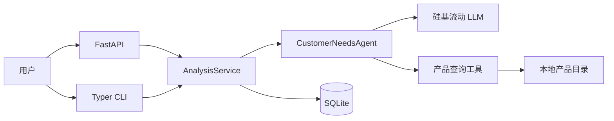

# 客户需求分析 Agent

一个面向企业软件选型的作品级 MVP。它把客户的自然语言需求整理成固定结构，在信息不足时主动追问，信息完整后调用本地产品查询工具，并且只推荐目录中真实存在的产品。

这个仓库的重点不是“让模型自由发挥”，而是演示如何用确定性工作流控制 Agent：模型负责语言理解和生成工具参数，Python 负责权限边界、数据校验、产品筛选、状态保存和错误处理。

## 你能从中学到什么

- System Prompt 如何定义角色、任务边界和完成条件。
- 如何通过硅基流动的 OpenAI 兼容接口完成 Tool Calling。
- Pydantic 如何生成 JSON Schema 并校验输入输出。
- SQLite 如何保存多轮会话和工具轨迹。
- Agent Loop 与确定性工作流如何组合。
- 如何用模型替身测试 Agent，而不依赖在线模型的随机结果。

## 总体架构



一次请求的核心路径是：恢复会话 → 结构化提取 → 检查缺失字段 → 生成工具参数 → 确定性筛选 → 生成推荐 → 校验并持久化。详细时序图见[架构说明](docs/architecture.md)。

## 快速开始

要求 Python 3.12 及以上。推荐安装 [uv](https://docs.astral.sh/uv/)，也可以使用普通虚拟环境和 pip。

```bash
uv sync --extra dev
cp .env.example .env
```

在 `.env` 中填写：

```dotenv
SILICONFLOW_API_KEY=你的密钥
SILICONFLOW_MODEL=模型广场中的模型_ID
```

所选模型需要支持 Tool Calling 和 Structured Outputs；模型能力可能调整，应以硅基流动模型广场和接口文档为准。

启动 API：

```bash
uv run uvicorn customer_needs_agent.api:create_app --factory --reload
```

浏览器打开：

- Swagger UI：<http://127.0.0.1:8000/docs>
- 健康检查：<http://127.0.0.1:8000/health>

使用 CLI：

```bash
uv run agent analyze "我们是零售企业，预算 3 万，希望两周上线，需要客户管理"
uv run agent chat
uv run agent show <conversation-id>
```

没有 uv 时：

```bash
python -m venv .venv
.venv/Scripts/python -m pip install -e ".[dev]"
.venv/Scripts/uvicorn customer_needs_agent.api:create_app --factory --reload
```

Linux/macOS 请将 `.venv/Scripts/` 换成 `.venv/bin/`。

## 完整对话示例

第一次请求：

```json
{
  "message": "我们是零售企业，需要客户管理"
}
```

响应会返回 `needs_clarification` 和一个 `conversation_id`。继续提交：

```json
{
  "message": "年度预算 3 万，希望两周上线",
  "conversation_id": "上一步返回的 UUID"
}
```

服务恢复前一轮状态，调用 `query_products`，最终只返回本地目录中的合适方案。工具参数与结果可通过 `GET /v1/conversations/{id}` 查看。

## 测试和质量检查

```bash
uv run pytest
uv run ruff check .
uv run mypy src
docker build -t customer-needs-agent .
```

默认测试完全离线。真实硅基流动调用仅用于人工冒烟验证，避免 CI 消耗额度。

## 项目结构

```text
src/customer_needs_agent/
├── api.py             # HTTP 入口
├── cli.py             # 命令行入口
├── service.py         # 应用用例
├── agent.py           # Agent 编排与业务不变量
├── llm.py             # 模型协议和硅基流动客户端
├── models.py          # Pydantic 数据契约
├── product_tool.py    # 确定性产品查询
├── repository.py      # SQLite 会话持久化
├── prompts.py         # 可审查的 System Prompt
└── data/products.json # 模拟产品目录
```

## 文档导航

- [架构与完整数据流](docs/architecture.md)
- [Agent Loop 与 Tool Calling](docs/agent-loop.md)
- [Pydantic、SQLite 和产品数据模型](docs/data-model.md)
- [HTTP API 使用说明](docs/api.md)
- [开发与扩展指南](docs/development.md)
- [测试策略与 20 条验收输入](docs/testing.md)
- [架构决策记录](docs/adr/README.md)

## 当前边界

- 仅处理中文文本，币种以人民币为主。
- 本地目录是演示数据，不代表真实厂商或真实报价。
- 没有账号、前端、向量数据库和外部产品 API。
- SQLite 适合单机 MVP；横向扩容时应替换为 PostgreSQL。

## License

[MIT](LICENSE)

