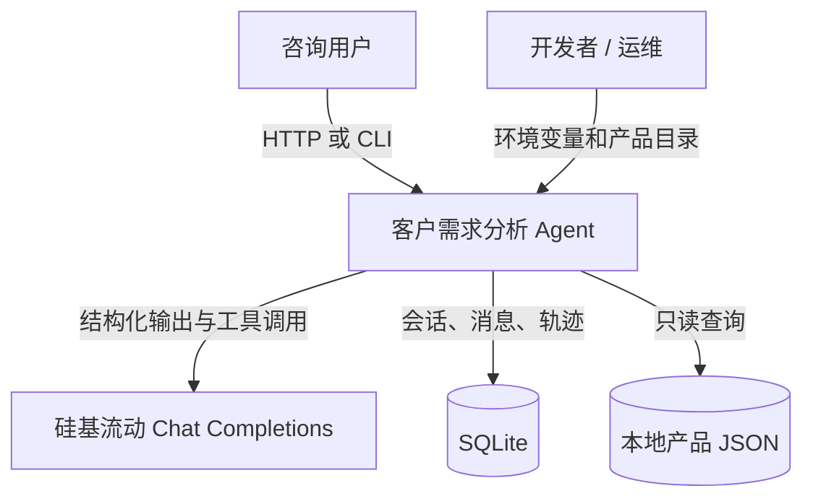
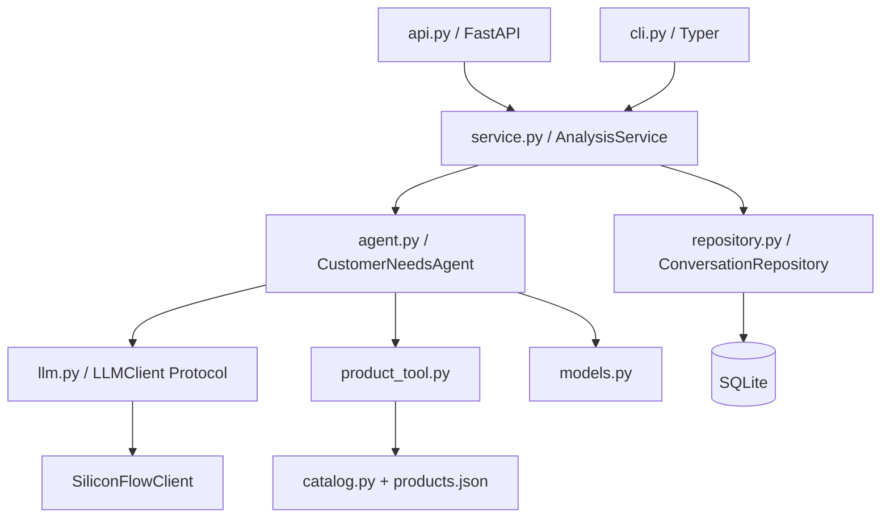
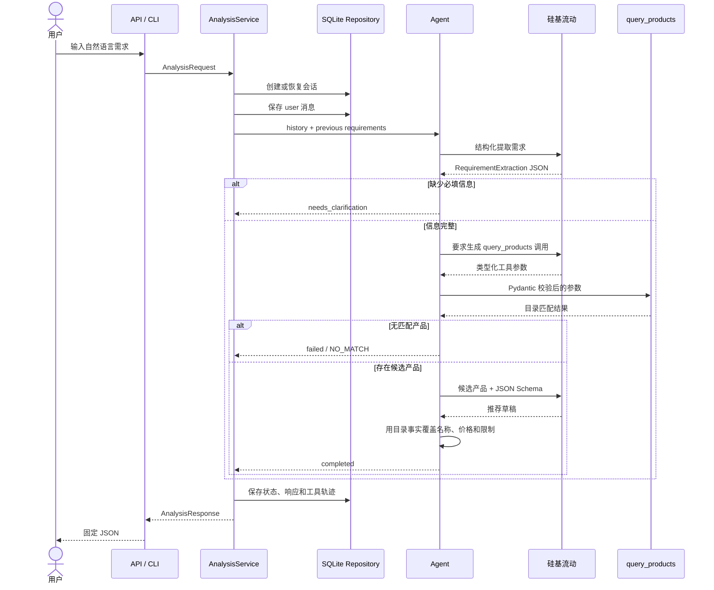
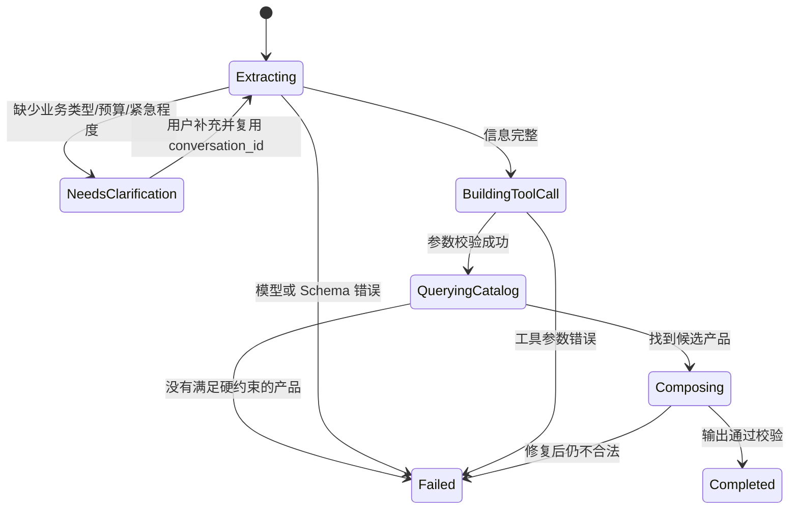

# 架构说明

本文回答三个问题：系统由哪些部分组成、一次请求如何流动、哪些决定交给模型而哪些必须由程序控制。

## 系统上下文



硅基流动只参与自然语言理解、工具参数生成和推荐理由撰写。产品是否存在、价格是否超预算、交付期是否满足等事实由本地代码判断。

## 模块与依赖方向



依赖只向内指向应用服务和领域逻辑。`CustomerNeedsAgent` 不导入 FastAPI、Typer 或 SQLAlchemy，因此可以单独测试，也可以复用于未来的网页或企业微信入口。

## 完整请求时序



## Agent 状态图



状态不是只存在于模型上下文中。`requirements_json` 和最终响应保存于 SQLite，因此进程重启后仍可继续会话。

## 数据流和边界

```text
自然语言
  → RequirementExtraction（Pydantic 校验）
  → Requirements（程序检查必填字段）
  → QueryProductsArgs（Pydantic 校验）
  → ProductMatch（确定性工具生成）
  → RecommendationDraft（Pydantic 校验）
  → Recommendation（目录事实回填）
  → AnalysisResponse（跨字段不变量校验）
```

### 交给模型的决定

- 从口语中识别行业、预算、紧急程度和能力需求。
- 信息不足时生成自然的追问。
- 把完整需求转换成工具参数。
- 在已知候选产品范围内撰写匹配理由。

### 由程序强制执行的规则

- 哪些字段是必填项。
- 工具参数的类型、范围和枚举值。
- 预算、行业和交付周期硬约束。
- 产品只能来自本地目录。
- 产品名称、价格和限制以目录为准。
- 状态与响应字段必须一致。
- 循环步数、格式修复次数和错误暴露范围。

这种混合架构比“让模型直接看目录然后自由推荐”更容易测试、审计和解释。

## 失败隔离

- 模型供应商错误被转换为稳定的业务错误码。
- 429、500、503、504标记为可重试；认证和参数错误不标记为可重试。
- 无匹配产品返回 `NO_MATCH`，不降低硬约束来凑答案。
- Pydantic 拒绝额外字段和非法枚举。
- Agent 最多执行配置指定的步骤数，结构化输出仅修复一次。
- 日志只保存请求标识和运行元数据，不保存 API Key。

