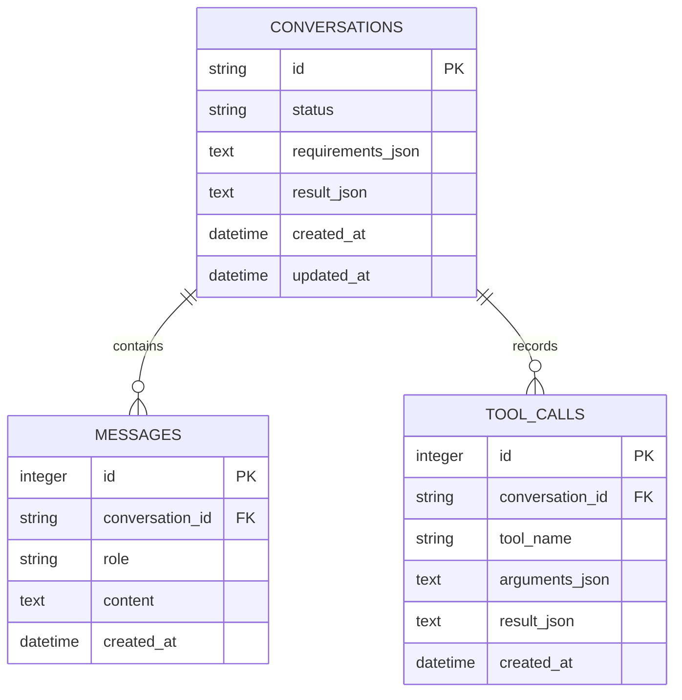

# 数据模型

## Pydantic 模型链

- `AnalysisRequest`：API 和 CLI 的统一输入。
- `RequirementExtraction`：模型提取结果和可选追问。
- `Requirements`：业务类型、预算、紧急程度、能力列表。
- `QueryProductsArgs`：唯一产品工具的参数。
- `Product` / `ProductMatch`：目录事实和查询结果。
- `RecommendationDraft`：模型生成的推荐草稿。
- `AnalysisResponse`：所有入口共用的最终响应。

所有模型均设置 `extra="forbid"`。例如模型多生成一个 `confidence` 字段也会被拒绝，防止接口在不知情时漂移。

`AnalysisResponse` 还执行跨字段校验：待澄清必须有问题且不能有推荐；完成必须有推荐；失败必须有错误详情。

## SQLite 实体关系



JSON 字段仍会在写入前经过 Pydantic 校验。MVP 使用文本列是为了保持 SQLite 简单；迁移 PostgreSQL 时可换成原生 JSONB。

## 产品目录

目录位于 `src/customer_needs_agent/data/products.json`，启动后按 `Product` 模型验证。示例：

```json
{
  "id": "crm-starter",
  "name": "启航 CRM",
  "category": "CRM",
  "annual_price": 18000,
  "industries": ["通用", "零售", "专业服务"],
  "capabilities": ["客户管理", "销售漏斗", "线索管理", "移动办公"],
  "delivery_days": 5,
  "suitable_company_sizes": ["小微", "中小"],
  "limitations": ["不含复杂渠道管理", "标准版仅支持 30 个账号"]
}
```

产品和价格都是教学模拟数据，不代表真实品牌或报价。

## 筛选和评分

硬约束依次是：

1. 年费不得超过预算上限。
2. 交付天数不得超过紧急程度对应期限。
3. 产品必须适用于客户行业，或声明为“通用”。
4. 客户明确要求能力时，至少命中一项。

通过硬约束后，能力覆盖率占 80 分，预算余量占 20 分。最后按得分降序、价格升序、产品 ID 升序排列，保证相同输入得到稳定结果。

